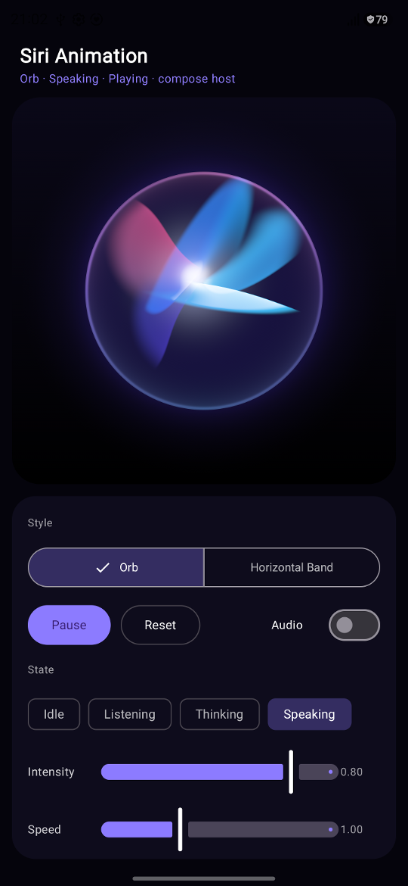
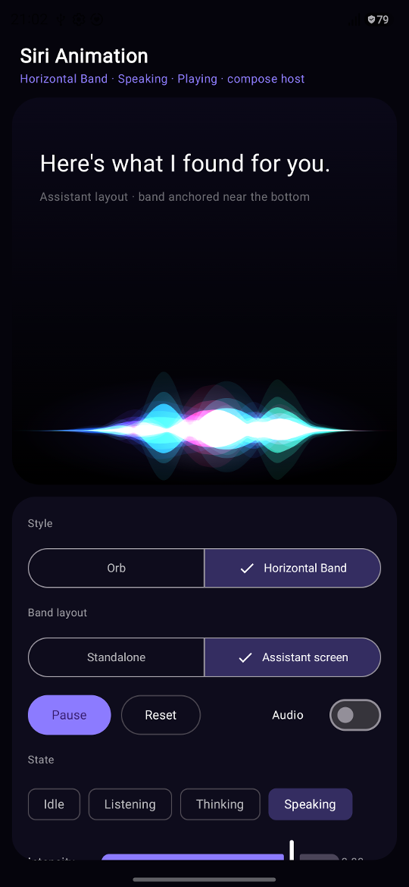

# SiriAnimation

An Android library with two Siri-inspired voice-assistant animations, rendered procedurally with `Canvas`:

- **Orb**: a dark glass sphere with large, translucent fans of colored light that turn in 3D around a white-hot core, a thin glassy rim and a soft glow.
- **Horizontal band**: a flowing, multicolored ribbon of light with a bright center and soft glow.

<p align="center">
  
  &nbsp;&nbsp;
  
</p>
<p align="center"><sub>The demo app on a phone: orb (left) and horizontal band (right), speaking state.</sub></p>

You can use either style as a **Jetpack Compose composable** (`SiriAnimation`) or as a **classic View** (`SiriAnimationView`). Both share the same rendering engine.

> This project is not affiliated with or endorsed by Apple. It uses no Apple assets. The visuals are original procedural recreations.

## Features
- Two distinct styles with a smooth crossfade when you switch at runtime
- Visual states (`IDLE`, `LISTENING`, `THINKING`, `SPEAKING`) with eased transitions
- Presets (`CLASSIC`, `VIBRANT`, `SUBTLE`, `CUSTOM`) and a custom palette API
- Controls for intensity, speed and glow, plus band and orb layout settings
- Optional audio reactivity: you pass a normalized level. The library never records audio and needs no permissions.
- Uses elapsed time, so motion is correct at 60/90/120 Hz. The draw loop doesn't allocate, and pause/resume never jumps.
- Rendering stops when the animation is paused, invisible, detached or (in Compose) when the lifecycle drops below STARTED.

**Min SDK 23.**

### How the orb is rendered
The interior is made of five "folded fans". Each fan is a smooth, flat sector of light lying in its own tilted plane through a wandering hot core.
- **Depth from the planes:**
  - Because the planes are tilted in 3D, they foreshorten into petals and turn into thin bright lines when seen nearly edge-on.
  - Each fan has one crisp, brighter fold edge and a soft trailing side.
  - Parts of a fan behind the core are dimmer, bluer and slightly blurred, and fans in front partly hide the ones behind.
  - The glass adds a dark body, a faint fresnel, a thin rim lit where fans reach it, and an outer glow.
- **Motion:**
  - Every fan turns, tilts and breathes on its own slow, unrelated rhythm, so the orb never shows a global rotation or a visible loop.
  - Fan colors drift slowly through the palette.
  - States and audio change amplitudes (width, twist, size, brightness), never the timing, so state changes stay smooth.
- **Shared math:**
  - All animation is computed once per frame in Kotlin (`OrbField`), with a double-precision clock that never wraps.
  - The GPU and CPU paths shade with the same numbers.
- **API 33 and newer:**
  - A single AGSL `RuntimeShader` evaluates every pixel analytically: one ray–plane intersection per fan, with no ray marching.
  - It is compiled once. Each frame only uploads float uniforms.
  - If a device rejects the shader, the orb falls back to the CPU renderer instead of crashing.
- **API 23–32 (and the "force CPU" switch):**
  - The same per-pixel function fills a small bitmap, which is drawn as an anti-aliased circle.
  - Rows are shared between the UI thread and up to three worker threads.
  - The bitmap is 48–128 texels across. The size adapts to the measured cost, with a budget of 4 ms per frame.
  - The rim line, the rim highlights and the outer glow are drawn at full resolution with Canvas gradients.
  - **Differences from the GPU path:**
    - softer fan edges, at about one texel;
    - the glow has a fixed tint;
    - rim highlights are approximated with arcs.
- **Measured on one device** (Galaxy SM-S928B, API 36, 120 Hz, debug build, `dumpsys gfxinfo`):

  | Path | Orb size | Result |
  |---|---|---|
  | GPU | about 330 px | 120 fps, 0 janky frames, frame p90 6 ms, GPU p90 2 ms |
  | GPU | about 520 px | 0 janky frames, frame p90 7 ms, GPU p90 3 ms |
  | GPU | about 830 px (portrait) | 0 janky frames, frame p90 9 ms, GPU p90 5 ms |
  | Forced CPU | about 330 px | 0 janky frames, frame p90 7 ms; settles at 48 texels (64 texels cost about 4.7 ms with 4 threads) |
  | Forced CPU | about 830 px (portrait) | 0 janky frames, frame p90 8 ms; 48 texels, so the interior is visibly soft at this size |

  Older phones will be slower on the fallback and will stay at the lower resolutions.

The band uses standard `Canvas` APIs on every API level.

This is a procedural recreation of the look. It is not Apple's implementation.

## Installation (JitPack)

`settings.gradle.kts`:
```kotlin
dependencyResolutionManagement {
    repositories {
        google()
        mavenCentral()
        maven("https://jitpack.io")
    }
}
```
Module `build.gradle.kts`:
```kotlin
dependencies {
    implementation("com.github.slaviboy:SiriAnimation:1.0.0")
}
```
This uses the coordinates `com.github.<GitHubUser>:<Repository>:<tag>`. If you publish from a different account or repository name, change them to match.

## Jetpack Compose

```kotlin
SiriAnimation(
    style = SiriAnimationStyle.ORB,
    state = SiriAnimationState.LISTENING,
    modifier = Modifier.size(260.dp)
)
```

Band near the bottom of a full-screen assistant UI:
```kotlin
Box(Modifier.fillMaxSize().background(Color.Black)) {
    SiriAnimation(
        style = SiriAnimationStyle.HORIZONTAL_BAND,
        state = state,
        config = SiriAnimationConfig.ASSISTANT_BAND, // bandVerticalBias = 0.86, bandHeightFraction = 0.28
        modifier = Modifier.fillMaxSize()
    )
}
```
To use it as a standalone strip, give it a fixed height: `Modifier.fillMaxWidth().height(140.dp)` with the default config.

Changing `style` or `state` animates the transition automatically.

## Views (Kotlin)

```kotlin
val siriView = SiriAnimationView(context).apply {
    style = SiriAnimationStyle.ORB
}
siriView.setStyle(SiriAnimationStyle.HORIZONTAL_BAND)          // crossfade
siriView.setStyle(SiriAnimationStyle.ORB, animate = false)     // instant
siriView.setState(SiriAnimationState.SPEAKING)
siriView.updateConfig { it.copy(intensity = 1f, glowIntensity = 1.4f) }
siriView.pause(); siriView.play()
```

## XML

```xml
<com.slaviboy.sirianimation.SiriAnimationView
    android:layout_width="match_parent"
    android:layout_height="160dp"
    android:background="#000"
    app:siri_style="horizontal_band"
    app:siri_state="listening"
    app:siri_preset="vibrant"
    app:siri_intensity="0.9"
    app:siri_glowIntensity="1.2" />
```
All attributes: `siri_style`, `siri_state`, `siri_preset`, `siri_intensity`, `siri_speed`, `siri_glowIntensity`, `siri_animated`, `siri_orbSizeFraction`, `siri_bandHeightFraction`, `siri_bandVerticalBias`, `siri_audioReactivity`, `siri_coreIntensity`, `siri_glowEnabled`, `siri_glowRadius`.

## Configuration

| Property | Range | Default | Effect |
|---|---|---|---|
| `intensity` | 0..1 | 0.8 | Motion amplitude and brightness |
| `speed` | 0..3 | 1.0 | Animation speed multiplier |
| `glowIntensity` | 0..2 | 1.0 | Bloom/haze strength |
| `isAnimated` | – | true | `false` shows a static frame |
| `preset` | enum | CLASSIC | Palette + tuning |
| `customPalette` | `SiriPalette?` | null | Used with `CUSTOM` |
| `orbSizeFraction` | 0.2..1 | 0.6 | Orb diameter relative to the smaller side (the remaining space holds the glow) |
| `bandHeightFraction` | 0.05..1 | 0.6 | Band region height relative to the drawing area |
| `bandVerticalBias` | 0..1 | 0.5 | Band center: 0 = top, 1 = bottom |
| `audioReactivity` | 0..2 | 1.0 | How strongly the audio level drives motion |
| `coreIntensity` | 0..2 | 1.0 | Strength of the orb's internal light |
| `isGlowEnabled` | – | true | Turn the outer glow on or off (the change is eased) |
| `glowRadius` | 0.5..2 | 1.0 | How far the orb's outer glow spreads (eased). Limited by the space around the orb; the band ignores it |

Invalid values throw `IllegalArgumentException`. Changes to intensity and glow are eased in smoothly.

> Adding `glowRadius` changes the constructor and `copy` signatures of `SiriAnimationConfig`. Kotlin source that uses named or default arguments keeps compiling. Any already-compiled code (Kotlin or Java) that constructs or copies `SiriAnimationConfig` must be recompiled against this version, so publish it under a new version tag.

### Presets
- `CLASSIC`: electric blue, cyan, turquoise, violet, magenta and pink, with balanced motion.
- `VIBRANT`: neon saturation, brighter, with stronger glow and motion.
- `SUBTLE`: pastel colors, calmer motion and softer glow.
- `CUSTOM`: your palette:
```kotlin
val config = SiriAnimationConfig(
    preset = SiriAnimationPreset.CUSTOM,
    customPalette = SiriPalette(
        colors = listOf(0xFFFF6A3D.toInt(), 0xFFFFC23D.toInt(), 0xFFFF2E88.toInt()),
        glowColor = 0xFFFF4D6D.toInt()
    )
)
```

### States
States are purely visual; the library does no speech recognition. Transitions between them are eased over about a second.
- `IDLE`: slow, subtle motion
- `LISTENING`: gentle pulses
- `THINKING`: swirling, evolving patterns
- `SPEAKING`: strong, pronounced motion

## Audio reactivity
Compute a 0..1 level in your own audio pipeline (for example, RMS from `AudioRecord` or `Visualizer`) and pass it in.
```kotlin
// Compose: the lambda is read every frame, so no recomposition per sample
SiriAnimation(style, state = SiriAnimationState.SPEAKING, audioLevel = { latestRms })

// View
siriView.setAudioLevel(rms)   // main thread
```
The level is smoothed with a fast attack and a slow release.

## Performance notes
- **Frame timing.** The View uses `postInvalidateOnAnimation`; Compose uses `withFrameNanos`.
- **Threads.** The only background threads are the CPU orb renderer's row workers (at most three). They park between frames and stop when the view is detached.
- **Per-frame work.** The orb shader is compiled once per renderer, and a frame only uploads float uniforms. Gradients and bitmaps are only created when the size, palette or layout config changes. Per-frame work reuses `Path`, arrays and paints and doesn't allocate.
- **Layers.**
  - The band draws inside one offscreen layer, so its additive blending never affects content behind it.
  - The orb skips that layer except while crossfading between styles.
  - Very large views cost more fill-rate.
- **Measured numbers** are in [How the orb is rendered](#how-the-orb-is-rendered). For your target devices, measure with `dumpsys gfxinfo` or the GPU profiler.

## Demo
Open the project in Android Studio and run the `app` configuration. The demo includes:
- a style selector, band layout (standalone or assistant screen), play/pause and reset
- state chips, sliders for intensity, speed, glow, glow size and core, and preset chips
- simulated audio
- an outer-glow switch and a "force CPU orb renderer" switch
- a **Compare** diagnostic for the orb: GPU shader next to the CPU fallback, or glow on next to glow off
- a switch between the Compose host and the View host

You can also set start values with intent extras, for repeatable screenshots and profiling:
```
adb shell am start -S -n com.slaviboy.sirianimation/.demo.MainActivity \
    --es state speaking --es compare renderers --ez forceCpu false --ez paused false --ef orbSize 0.62
```
The extras are:
- `state`: `idle`, `listening`, `thinking` or `speaking`
- `style`: `orb` or `horizontal_band`
- `compare`: `off`, `renderers` or `glow`
- `forceCpu` and `paused`: booleans
- `orbSize`: 0.2 to 1

## Previews and tests
`./gradlew :sirianimation:testDebugUnitTest` renders the orb on the JVM with the same per-pixel math as the shader. It writes PNGs to `sirianimation/build/orb-preview/`:
- `contact_sheet.png`: the 4 states (plus speaking with audio) at several times
- `cpu_sheet.png`: the CPU fallback's look
- `metrics.csv`: the measured look metrics

The tests check:
- **Look metrics:** dark glass area, highlights, white clipping, hue spread, crisp edges, halo falloff, and that the rim stays brighter than the halo.
- **Smooth motion:** no pops, never static, and continuous uniforms even while the state changes.
- **Shader contract:** the AGSL and the Kotlin model use the same uniforms, constants and stage order.
- **Efficiency and threading:** the frame loop doesn't allocate, and the multi-threaded CPU renderer is bit-identical to one thread.

## Publishing a release
1. Push the repository to GitHub, for example `github.com/slaviboy/SiriAnimation`.
2. Tag a release: `git tag 1.0.0 && git push origin 1.0.0`.
3. Open `https://jitpack.io/#slaviboy/SiriAnimation`, click **Get it** next to the tag and check the build log.

`jitpack.yml` builds with JDK 17 and runs `./gradlew :sirianimation:publishToMavenLocal`. That publishes only the library (artifact `sirianimation`, release variant with sources). To check the publish locally, run `./gradlew :sirianimation:publishToMavenLocal`.

## Troubleshooting
- **Nothing visible**: give the view a non-zero size. Also check it isn't drawn over a light background; the effect is designed for dark backgrounds.
- **Orb glow cut off**: lower `orbSizeFraction` or make the view larger.
- **Band too thin or too tall**: adjust `bandHeightFraction` and the view height.
- **JitPack build fails**: the build needs JDK 17 or newer, which `jitpack.yml` sets. Make sure the tag contains `gradlew` and `gradle/wrapper`.
